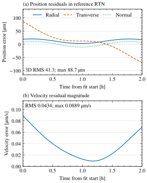
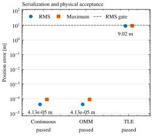
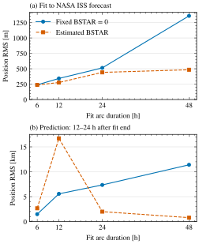

<!-- @brief Present the generated publication gallery with numerical provenance and reproduction commands. @author watson -->
# Example figures

Generated by watson with the optional SciencePlots/Matplotlib tool. All three figures are available as vector PDF and SVG, plus 600 dpi PNG. The page width is 3.5 in, type is 9 pt, and PDFs embed TrueType subsets. Review the [full captions](captions.md) with the figures; the [manifest](manifest.json) records input, source, artifact, and font hashes plus environment versions. See the [plotting guide](../plotting.md) for other widths, fonts, and input contracts.

## Continuous residuals



[PDF](residuals.pdf) · [SVG](residuals.svg) · [PNG](residuals.png)

Position residuals use the supplied states' RTN axes. Velocity is the magnitude of the TEME velocity difference. This synthetic example tests fitting and serialization, not real spacecraft accuracy.

## Serialization



[PDF](serialization.pdf) · [SVG](serialization.svg) · [PNG](serialization.png)

Approximately 41 µm continuous position RMS becomes 9.02 m after TLE serialization and reparse. The 10 m gate applies to RMS; maximum error is shown separately.

## ISS prediction



[PDF](iss-prediction.pdf) · [SVG](iss-prediction.svg) · [PNG](iss-prediction.png)

Fitting BSTAR can reduce training error while worsening prediction. These are comparisons with a NASA forecast, not tracking truth. The held-out window is 12–24 h after each individual fit end; absolute prediction epochs differ between arc lengths.

## Numerical provenance

The retained [request](input/request.json) and [report](input/report.json) are exact native CLI output from `examples/fit.yaml` and `examples/states.csv`: 61 synthetic TEME position/velocity samples spanning two hours from `2026-01-01T00:00:00Z`. watson generated this snapshot on 2026-10-24 with native orbit-fit commit `fd9ac6782556578cfc3b81ced896f1689c3e5a35`, macOS arm64, AppleClang 21.0.0.21000334, Release configuration, and the repository's pinned CPM dependencies. Automatic initialization, fixed BSTAR, and the default TLE-required policy produced an accepted fit in three iterations. Strict native JSON has no comment fields; authorship and purpose are recorded here.

```sh
build/release/orbit-fit fit --config examples/fit.yaml --output-dir results
```

The third figure reads the existing [ISS comparison CSV](../benchmarks/2026-10-24-iss-comparison-macos-arm64.csv), without rerunning fitting or propagation. Its numerical provenance and limits are in the [qualification report](../../qualification/README.md). Only the orbit-fit reparsed-TLE rows are displayed; the retained CSV also contains other products and the external fitter. The original NASA data and other upstream contributions keep their attribution.

## Reproduce the gallery

From the repository root, using the retained native snapshot:

```sh
uv sync --locked --project tools/plots --python 3.12
uv run --locked --project tools/plots orbitfit-plot fit docs/figures/input \
  --qualification docs/benchmarks/2026-10-24-iss-comparison-macos-arm64.csv \
  --output-dir gallery-reproduced
```

This needs no C++ build and no TeX installation. For a fresh native fit, use `results` from the native command above instead. Regenerating numerical inputs with a different compiler or solver revision may change residuals; rendering on another platform may change artifact bytes. The manifest identifies the exact inputs and renderer used for these checked-in figures. Generated binary/vector artifacts retain author and description metadata; `captions.md` carries the text-file purpose and author header. Do not edit plot pixels, SVG paths, or the manifest by hand.
